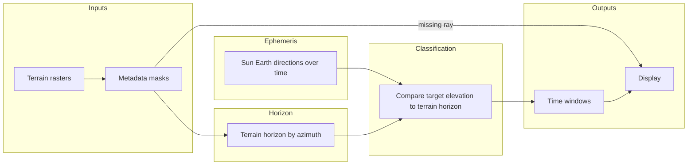

# Engine calculation pipeline (concept)

**Status:** training reference for the intended full pipeline — not an implemented production path in this repository.

This note summarizes **stages and contracts** for a terrain-aware visibility navigator. For staged method detail see **[METHOD_DECISION.md](METHOD_DECISION.md)**. For benchmark metrics and gate language see **[BENCHMARK_PLAN.md](BENCHMARK_PLAN.md)**. For frame, notebook, and horizon terminology see **[FRAME_GEOMETRY_VALIDATION.md](FRAME_GEOMETRY_VALIDATION.md)**. For far-field terrain and Product 69/90 *research* context see **[FAR_FIELD_B5_B6_PLAN.md](FAR_FIELD_B5_B6_PLAN.md)**.

## Stages

1. **Terrain input** — DEM / multiband stack (and metadata) covering the observer and required azimuths.
2. **Metadata and coverage checks** — CRS, nodata, masks, dtype, scale/offset, footprint; reject or flag incomplete rays.
3. **Terrain horizon by azimuth** — along each azimuth, derive the maximum blocking elevation (or equivalent) from valid samples; missing required samples → no classified clearance on that ray.
4. **Time-tagged Sun and Earth directions** — ephemeris (e.g. SPICE) or another documented source; observer position, frame, and time scale must match the benchmark plan.
5. **Visibility classification** — compare **target elevation** to **terrain horizon** on the relevant azimuth when terrain is known (see contract below).
6. **Time windows** — merge contiguous intervals per body and label transitions.
7. **Display** — geometric vs terrain horizons, body markers, and **clear / blocked / unknown** (not color-only).

## Definitions

- **Geometric horizon** — horizon for a smooth reference surface (e.g. sphere/ellipsoid at the observer), **without** local terrain relief. A target can be above this and still hidden behind terrain.
- **Terrain horizon** — horizon angle from terrain/occlusion along the azimuth of interest, derived from validated elevation data and sampling rules.
- **Centre-ray visibility** — comparison of the **centre** of the apparent disk to the terrain horizon in that direction. It is **not** finite-disc visibility (partial disk), **not** solar power, **not** a communications link budget, and **not** landing safety.

## State contract (centre-ray vs terrain)

| State | Meaning |
|--------|--------|
| **clear** | Required terrain data for that ray is **known**, and target elevation is **strictly above** the terrain horizon. |
| **blocked** | Required terrain data is **known**, and target elevation is **at or below** the terrain horizon. |
| **unknown** | Required terrain coverage is **missing** or **masked** on that ray (or otherwise not computable). **Unknown must never be treated as clear.** |

## Synthetic / demo scope

The static prototype ([`prototype/index.html`](prototype/index.html)) and unit tests under `tests/test_horizon_visibility_semantics.py` use **invented** terrain profiles and angles in a **simplified local plane** — not validated lunar geodesy, frames, or ephemeris. They exist to rehearse **labels and state logic** only.

For JupyterHub vs API vs prototype boundaries see **[JUPYTER_PRACTICE_PASS.md](JUPYTER_PRACTICE_PASS.md)**.

## Flow diagram

